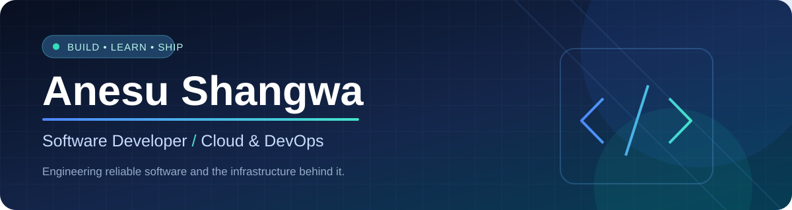

 

### 🚀 Have a software idea? Let's build it.

**Need a website, web application, mobile app, or custom business system?**

I help turn ideas and business needs into practical digital solutions—from planning and development to deployment. **Let's discuss your project.**

**📱 WhatsApp:** [+263 77 499 8764](https://wa.me/263774998764) &nbsp; | &nbsp; **✉️ Email:** [anesushangwa01@gmail.com](mailto:anesushangwa01@gmail.com)

 

**Building software today. Engineering the cloud behind it tomorrow.**

Software Development &nbsp;•&nbsp; Cloud Infrastructure &nbsp;•&nbsp; DevOps & Automation

 

## 👨‍💻 A little about me

I'm **Anesu**, a BYU–Idaho software development graduate and a current Ensign College System Administration certificate student—and a software developer who enjoys building web and mobile applications—and understanding everything it takes to run them in the real world.

- 🔭 **Building:** practical applications and backend services
- ☁️ **Exploring:** Microsoft Azure, AWS, cloud architecture and operations
- ⚙️ **Practicing:** Infrastructure as Code, containers, networking and Linux
- 🧭 **Growing toward:** Cloud / Platform Engineering
- 💡 **My approach:** learn by building, document what works, improve what doesn't

## 🚀 Featured projects

A selection of real-world platforms I've contributed to, spanning **commerce, careers, and logistics**.

<table>
<tr>
<td width="33%" valign="top">

### 🛍️ Cleeka
**E-commerce & marketplace**

Online shopping platform featuring product discovery across multiple categories, customer shopping experiences, and vendor access.

[**Visit Cleeka ↗**](https://cleeka.com/)

</td>
<td width="33%" valign="top">

### 🌱 Kukura Zimbabwe
**Careers & opportunities**

Career-oriented digital platform connecting students and employers, focused on improving access to opportunities.

[**Visit Kukura ↗**](https://www.kukurazimbabwe.org/)

</td>
<td width="33%" valign="top">

### 🚚 TruckGo
**Transport & logistics**

Transport-focused software project supporting the digitization of truck and logistics services.

[**Visit TruckGo ↗**](https://truckgo.co.zw/)

</td>
</tr>
</table>

> These are collaborative projects I've worked on. Each showcases a different real-world problem and product domain.

## 🎓 Education & qualifications

A foundation in **software engineering** and an expanding focus on **systems, infrastructure, and cloud operations**.

<table>
<tr>
<td width="125" align="center" valign="middle">

</td>
<td valign="middle">

### Brigham Young University–Idaho

**Degree in Software Development**  

Software engineering · Application development · Programming · Databases

[University ↗](https://www.byui.edu/) · [Degree information ↗](https://www.byupathway.edu/bachelors-degree/software-development)

</td>
</tr>
</table>

<table>
<tr>
<td width="125" align="center" valign="middle">

</td>
<td valign="middle">

### Ensign College

**System Administration Certificate**  

Linux & Windows servers · Networking · Cloud infrastructure · Scripting

[College ↗](https://www.ensign.edu/) · [Certificate curriculum ↗](https://ensign.smartcatalogiq.com/en/2025-2026/academic-catalog/academic-programs/certificates/system-administration-certificate)

</td>
</tr>
</table>

<b>📜 Professional credentials & continuing education</b>

 

- **Microsoft Certified: Azure Fundamentals (AZ-900)** — earned certification
- **Oracle Cloud Infrastructure (OCI) 2025 Foundations** — listed credential
- **Multicloud Architect** — listed credential
- **Microsoft Azure Administration (AZ-104)** — learning focus
- **Terraform, AWS, Docker & Kubernetes** — hands-on professional development

## ⚡ Tech stack

**Cloud & Infrastructure**

**Development & Backend**

These are technologies I work with or am learning, not a claim of certification in all of them.

## 🛠️ Engineering focus

| 💻 Software engineering | ☁️ Cloud infrastructure | 🚀 DevOps & operations |
| :--- | :--- | :--- |
| Web and mobile applications | Azure & AWS fundamentals | Terraform (Infrastructure as Code) |
| Backend services and APIs | Virtual networks & Linux servers | Docker & Kubernetes |
| PostgreSQL & Supabase | Secure, scalable architecture | Git, automation & monitoring |

## 🧭 My learning roadmap

| Step | Focus | Why it matters |
| :---: | :--- | :--- |
| **01** | **Software development** | Build and understand real applications |
| **02** | **Azure administration · AZ-104** | Manage core cloud resources |
| **03** | **Terraform / Infrastructure as Code** | Provision repeatable environments |
| **04** | **AWS architecture** | Develop multi-cloud design skills |
| **05** | **DevOps · Linux · Kubernetes** | Operate and automate reliable services |
| **06** | **Cloud / Platform Engineering** | Bring software and infrastructure together |

## 📈 GitHub in action

> Great engineering is more than writing code. It's also deploying it, securing it and making it dependable.

---

**Open to learning, collaboration and meaningful engineering challenges.**

[**Explore my work →**](https://github.com/anesushangwa01?tab=repositories)

Made with curiosity, code and continuous learning ☁️

